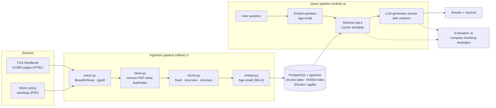

# motor-claim-rag-lab

A hands-on Retrieval-Augmented Generation (RAG) pipeline for **UK motor insurance**. It answers questions about motor claims and policies, grounded in real regulatory text (the FCA ICOBS Handbook) and motor policy wordings, with citations back to the source rule or page.

The project is built step by step as a learning lab. Each stage is a small, standalone script whose output can be inspected, so design choices (for example, chunking strategies) can be compared on real data.

## Status

| Stage | Status | Output |
|---|---|---|
| Collect | ✅ Done | 15 FCA ICOBS pages + 3 motor policy PDFs (`data/sources.csv`) |
| Parse | ✅ Done | `data/parsed.jsonl`, 217 records (one per FCA provision / PDF page) |
| Clean | ✅ Done | `data/cleaned.jsonl`, 213 records |
| Chunk | ✅ Done | 3 strategies: fixed (185), recursive (228), structure (270) |
| Embed + Store | ✅ Done | 683 vectors in Postgres + pgvector |
| Retrieve | 🔜 Next | Top-k semantic search, compared across chunking strategies |
| Generate | 🔜 Planned | LLM answer with citations |
| Evaluate | 🔜 Planned | Retrieval and answer quality metrics |

## Architecture



### What gets stored

Each row in the `chunks` table holds the vector **and** what's needed to use and cite it:

| Column | Purpose |
|---|---|
| `embedding` | 384-dimension bge-small vector, used for similarity search |
| `text` | The chunk text the LLM reads |
| `chunk_id`, `strategy` | Unique ID and which chunker produced it |
| `doc_id`, `doc_type`, `title`, `source_url` | Source document |
| `access` | `public` or `internal`, for access-aware filtering |
| `rule_ids`, `pages`, `citations` | ICOBS rule numbers / PDF pages for citations |
| `n_tokens` | Chunk size |

### Chunking strategies compared

- **fixed**: fixed-size token windows with overlap (LangChain `TokenTextSplitter`). Ignores document structure.
- **recursive**: splits on paragraphs, then lines, sentences and words (LangChain `RecursiveCharacterTextSplitter`).
- **structure**: one chunk per FCA rule or PDF page, split further only if too long. Keeps citations precise.

## Tech stack

- **Python 3.12**, managed with **uv**
- **BeautifulSoup + lxml** (HTML parsing), **pypdf** (PDF parsing)
- **LangChain text splitters**, **tiktoken** (chunking and token counts)
- **sentence-transformers** with **BAAI/bge-small-en-v1.5** (embeddings, runs locally on CPU)
- **PostgreSQL + pgvector** in **Docker** (vector storage, HNSW index, cosine search)
- **psycopg 3**

## Project structure

```
motor-claim-rag-lab/
├── ingest/
│   ├── explore.py   # find the HTML element that holds FCA rule text
│   ├── parse.py     # HTML + PDF  -> data/parsed.jsonl
│   ├── clean.py     # parsed      -> data/cleaned.jsonl
│   ├── chunk.py     # cleaned     -> data/chunks_<strategy>.jsonl
│   └── embed.py     # chunks      -> Postgres (pgvector)
├── data/
│   └── sources.csv  # list of source documents and URLs
├── pyproject.toml
└── uv.lock
```

The raw documents and generated JSONL files aren't committed. Download the files listed in `data/sources.csv` into `data/raw/`, then run the pipeline.

## Running it

```bash
# 1. Install dependencies into the project's .venv
uv sync

# 2. Start Postgres with pgvector
docker run -d --name ragdb -e POSTGRES_PASSWORD=rag -e POSTGRES_DB=rag \
  -p 5432:5432 -v ragdb_data:/var/lib/postgresql/data pgvector/pgvector:pg16

# 3. Run the ingestion pipeline
uv run python ingest/parse.py
uv run python ingest/clean.py
uv run python ingest/chunk.py
uv run python ingest/embed.py
```

`embed.py` reads the connection string from `DATABASE_URL`, defaulting to the local container above.

## Production view (AWS)

How this pipeline would map onto an enterprise deployment:

| Local | AWS |
|---|---|
| `data/raw/`, `data/*.jsonl` | S3 (raw and processed zones) |
| `ingest/*.py` run by hand | Step Functions orchestrating Lambda / ECS tasks, triggered by S3 events |
| bge-small on CPU | Bedrock embeddings or a SageMaker endpoint |
| Docker `ragdb` | Aurora PostgreSQL + pgvector |
| (future) query script | API Gateway + ECS/Lambda query service + Bedrock LLM |
